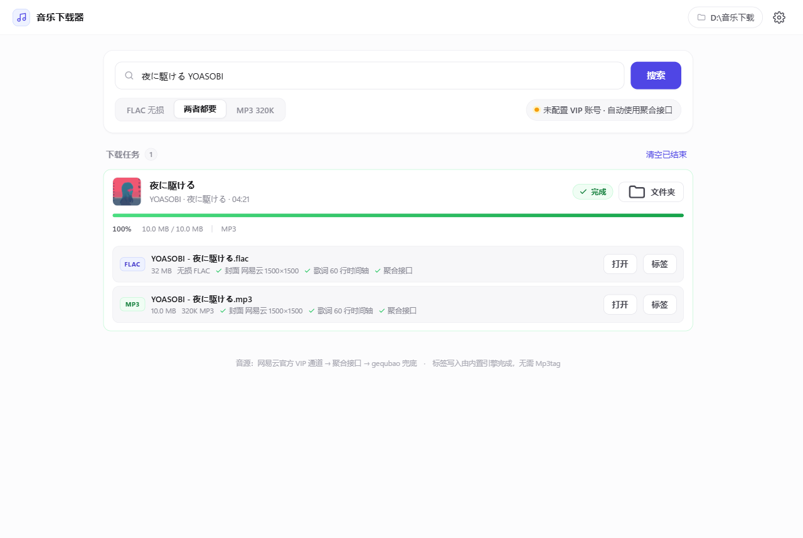
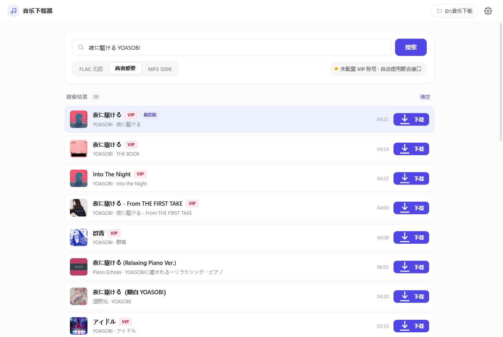
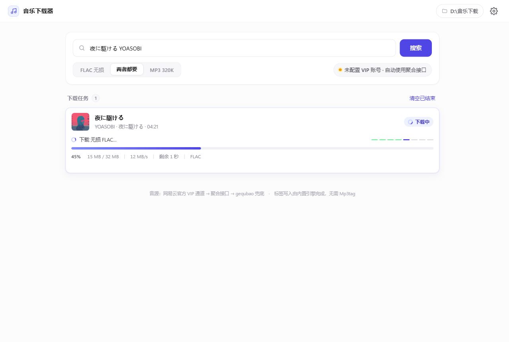
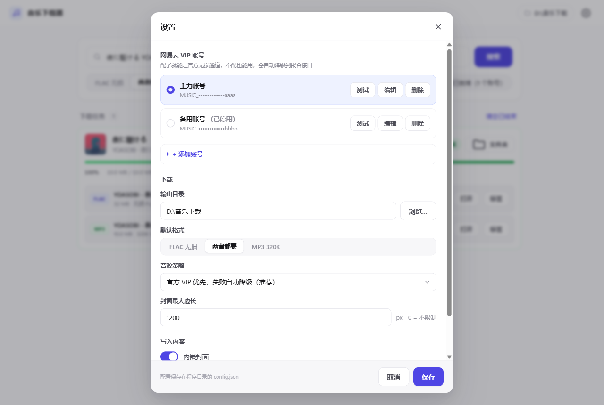
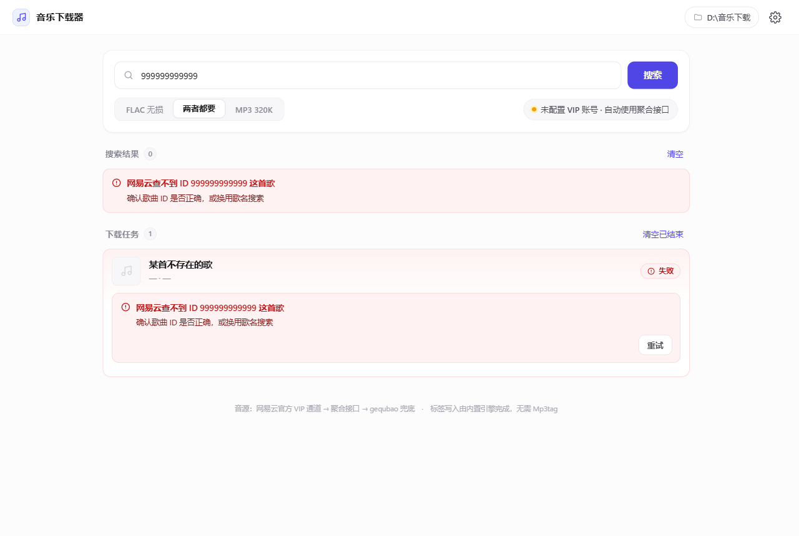

<div align="center">


# 音乐下载器

**搜歌 → 下载无损 → 封面、歌词、专辑信息自动写好**

白色简约风的 Windows 桌面应用，不需要懂技术，打开就能用。

[**⬇ 一键下载 Windows 版**](https://github.com/nishicouqie/music-downloader/releases/latest/download/music-downloader-win64.zip)　·　[**📱 Android 版**](https://github.com/nishicouqie/music-downloader-android)　·　[**🌐 项目主页**](https://nishicouqie.github.io/music-downloader/)　·　[常见问题](#常见问题)



</div>

---

## 它解决什么问题

从网上下载的音乐，十有八九是这样的：文件名乱码、没有封面、没有歌词、专辑和歌手是空的，
丢进播放器里就是一堆「未知艺术家」。

这个工具把这一整套活儿全包了：**下载音频的同时，把封面、歌词（带时间轴）、专辑、歌手、
年份、流派、音轨号一次性写进文件**。下载完直接就是可以归档的成品。

## 特性

| | |
|---|---|
| 🎧 **最高音质** | 优先取无损 FLAC（44.1kHz/16bit，~1090kbps），也可选 320K MP3 |
| 🖼 **封面自动挑选** | 同时在网易云和 iTunes 里找，自动用分辨率最高的那张（最高可到 3000×3000） |
| 🎵 **歌词带时间轴** | 日文原词 + 中文翻译合并成双语 LRC，MP3 还会写入 SYLT 逐行同步歌词 |
| 🔑 **VIP 账号管理** | Cookie 像 API Key 一样填写保存，可存多组随时切换，带一键有效性测试 |
| 📊 **进度看得见** | 实时百分比、速度、剩余时间，六个步骤指示器 |
| 💬 **报错说人话** | 每条错误都给「原因 + 该怎么办」，另附可展开的技术详情 |
| 🔁 **三级音源降级** | 官方通道 → 聚合接口 → 兜底源，逐级自动重试 |
| 🖥 **开箱即用** | 打包好的 exe，目标电脑不需要装 Python |
| ⌨️ **命令行版** | `music_dl.py` 支持批量下载，与界面版共用同一套引擎 |

## 快速开始

1. 点上面的「一键下载」按钮，或到 [Releases](https://github.com/nishicouqie/music-downloader/releases/latest) 下载 `music-downloader-win64.zip`（约 12 MB）
2. 解压到**任意普通目录**（比如 `D:\音乐下载器\`）
3. 双击 `音乐下载器.exe`
4. 搜索歌名 → 点「下载」

> **首次运行会被 Windows SmartScreen 拦一下**（因为没有买代码签名证书）。
> 点「更多信息」→「仍要运行」即可。杀毒软件误报同理。

支持的输入：歌名、`歌名 歌手`、网易云歌曲链接、网易云歌曲 ID，都能直接粘进去。

## 截图

**搜索结果** —— 带封面缩略图，自动标出最匹配的一条，VIP 曲目有标记



**下载中** —— 百分比、速度、剩余时间、当前阶段一目了然



**设置** —— Cookie 像 API Key 一样管理，可存多组、可切换、可一键测试



**报错** —— 说清楚是什么原因、该怎么办，还能展开看技术细节



## 设置 VIP 账号（可选）

不配账号也能用，程序会自动走第三方聚合接口拿无损。但如果你有网易云黑胶 VIP，
配上账号就能走**官方通道**，更稳定、更合规。

1. 浏览器打开并登录 <https://music.163.com>
2. 按 `F12` → 切到 **Application（应用）** 标签
3. 左侧 **Cookies** → `https://music.163.com`
4. 找到 `MUSIC_U`，复制它的 **Value**
5. 回到程序 → 右上角齿轮 → **+ 添加账号** → 粘贴 → 保存

保存后点「测试」，程序会当场验证这个 Cookie 是否有效、是什么会员等级、
**能不能真的取到无损直链**（不是只查个昵称就完事）。

> Cookie 只保存在本机 `config.json`，不会发往任何第三方。

## 音源是怎么取的

```
① 官方 VIP 通道    music.163.com/api/song/enhance/player/url/v1  + 你自己的 MUSIC_U
                    level=hires → lossless（无损）；exhigh（320K）
② 聚合接口         music-api.gdstudio.xyz   br=999 / 320
③ 兜底源           gequbao.com             仅酷我 128K，界面上会明确标注
```

逐级自动降级，每一级的失败原因都会被记录下来，最后一起展示。

### 音质是货真价实的吗

拿《永世のクレイドル》验证过：

| 验证项 | 结果 |
|---|---|
| 下载文件 MD5 vs 网易 CDN 文件名里的哈希 | `2681F356AB0682D336273B5C4CFC3E46` **完全一致** |
| 接口标称大小 vs 实际字节 | `37128729` = `37128729`，与网易 `sqMusic.size` 一致 |
| 频谱上限（防假无损） | **22.1 kHz**（128k 参照只到 16.8 kHz） |
| 打标签前后的 PCM 比对 | MD5 相同 → 打标签没有动过音频数据 |

仓库里的 `verify.py` 和 `verify_spectrum.py` 就是跑这些验证的脚本。

## 写入的标签

**MP3（ID3v2.3，兼容性最好）**

```
TIT2 标题   TPE1 歌手   TALB 专辑   TPE2 专辑艺术家
TRCK 音轨   TPOS 碟号   TDRC 日期   TCON 流派   COMM 备注
APIC 封面   USLT 整篇双语歌词   SYLT 逐行时间轴歌词   TXXX:SOURCE 音源
```

**FLAC（Vorbis Comment）**

```
TITLE  ARTIST  ALBUM  ALBUMARTIST  TRACKNUMBER  TRACKTOTAL
DISCNUMBER  DISCTOTAL  DATE  GENRE  COMMENT
LYRICS  UNSYNCEDLYRICS  LYRICS_ORIGINAL  METADATA_BLOCK_PICTURE
```

另外每个音频旁边会生成一个同名 `.lrc`，播放器通用性最好。

> **为什么不用 Mp3tag？** Mp3tag 官方文档写得很明确：*"Mp3tag is built as an
> interactive program, further commands are currently not planned."* 它只有
> `/fp`（打开目录）和 `/fn`（打开文件）两个命令行参数，**没有任何打标签的命令行
> 接口**，无法批处理。所以本程序用 [`mutagen`](https://mutagen.readthedocs.io/)
> 直接读写标签——做的事和 Mp3tag 内部完全一样，生成的都是标准格式，
> 随时可以丢进 Mp3tag 复核或再编辑。

## 从源码运行

```bash
pip install mutagen pywebview
python app.py                 # 原生窗口
python app.py --serve 8799    # 本地网页模式，用浏览器打开
python music_dl.py "歌名 歌手"  # 命令行版
```

命令行版还支持批量：

```bash
python music_dl.py --batch 歌单.txt      # 每行一首
python music_dl.py --id 455502615 --format both
python music_dl.py --test-cookie "MUSIC_U=xxx"
```

### 自己打包 exe

```bat
pip install pyinstaller
scripts\build_exe.bat
```

或者手动：

```bat
python -m PyInstaller --noconfirm --clean --windowed ^
  --name "音乐下载器" --icon icon.ico ^
  --add-data "ui;ui" --hidden-import clr ^
  --exclude-module tkinter --exclude-module numpy ^
  --exclude-module PIL --exclude-module matplotlib ^
  --exclude-module pandas --exclude-module unittest ^
  app.py
```

## 常见问题

<details>
<summary><b>双击 exe 一闪而过，没有窗口？</b></summary>

程序所在的**目录路径有问题**。已知 `D:\我的\程序\deepseek harness work\` 及其
子目录下会出现这种情况（实测 100% 复现），原因是该环境下 pythonnet 加载
`Python.Runtime.dll` 失败。把整个文件夹剪切到别处即可，比如
`D:\音乐下载器\`、`C:\Program Files\` 之类普通目录。

除此之外，纯 ASCII、中文、带空格、长短路径都测试过，全部正常。

</details>

<details>
<summary><b>提示「所有音源通道都没能取到直链」？</b></summary>

三级通道全挂了。常见原因：第三方聚合接口临时限流或停止服务，或者这首歌在各个
平台都需要付费购买。处理办法：

1. 点任务卡片上的「重试」
2. 到设置里检查 Cookie 是否还有效（点「测试」）
3. 如果聚合接口长期不可用，配一个自己的 VIP 账号走官方通道

</details>

<details>
<summary><b>VIP 曲目下载不了 / 只有 128K？</b></summary>

界面上会显示实际拿到的音质。如果显示「酷我 128K」，说明前两级通道都没成功，
降级到了兜底源。配一个网易云黑胶 VIP 账号走官方通道即可拿到无损。

</details>

<details>
<summary><b>会被封号吗？</b></summary>

正常使用频率下没有发现问题。但请**不要**用它高频批量抓取——那既可能触发风控，
也会给第三方服务造成负担。

</details>

<details>
<summary><b>能下载到手机里吗？</b></summary>

下载完把 `D:\音乐下载\` 里的文件拷到手机即可。如果要长期听，建议选
「MP3 320K」（体积小、兼容性最好）；如果要归档收藏，选「FLAC 无损」。

</details>

<details>
<summary><b>歌词时间轴是怎么来的？</b></summary>

来自网易云歌词接口，原始数据本身就是带毫秒时间轴的 LRC，还附带中文翻译。
程序把两者按时间戳对齐合并成双语 LRC，再分别写进 `.lrc` 旁挂文件、
`USLT`/`LYRICS` 文本字段，以及 MP3 的 `SYLT` 逐行同步歌词。

</details>

## 免责声明

- 本工具仅供**个人学习与技术研究**使用，请勿用于商业用途或大规模分发。
- 请**只下载你有权获取的内容**。通过第三方接口获取需要付费的会员内容属于
  灰色地带，由此产生的一切后果由使用者自行承担。
- 推荐的做法是配置你自己**已经付费购买**的 VIP 账号，走官方通道下载——
  这是你的正当权益，也最稳定合规。
- 第三方接口（`music-api.gdstudio.xyz`、`gequbao.com`）与本项目无关，
  它们的可用性和行为随时可能变化。
- 本项目不包含、不托管任何音乐文件。

## 致谢

- [mutagen](https://mutagen.readthedocs.io/) —— 音频标签读写
- [pywebview](https://pywebview.flowrl.com/) —— 原生窗口
- 界面用纯 HTML/CSS/JS 手写，没有前端框架

## 相关项目

| 版本 | 说明 |
|---|---|
| **电脑版（Windows）**（本仓库） | 白色简约桌面应用，支持命令行批量下载 |
| [**Android 版**](https://github.com/nishicouqie/music-downloader-android) | 手机端。会直接把文件写进系统 `Music/` 目录，播放器立刻能扫到；内置文件搬运，还能把这里配好的账号通过配置文件导入过去 |

两个版本共用同一套音源逻辑和标签规范，在电脑上配好的 VIP 账号可以「导出配置文件」后导入手机版。

## License

[MIT](LICENSE)
